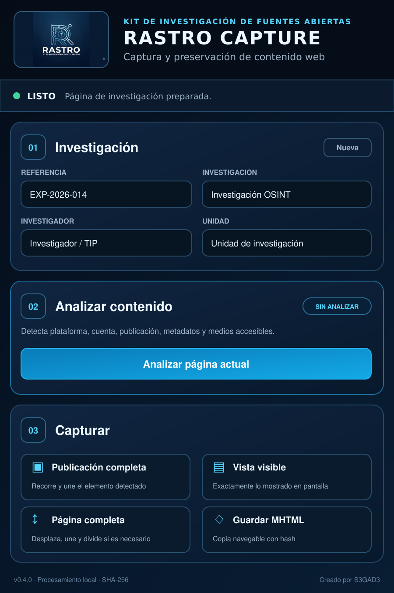

# RASTRO CAPTURE

Extensión Chromium para capturar, contextualizar y conservar contenido web durante investigaciones OSINT. La versión 0.4.0 está optimizada para publicaciones, reels, vídeos y perfiles de **Instagram** y **TikTok**.



> **Ámbito:** herramienta de apoyo a la documentación y preservación local. No evita autenticación, controles de acceso, cifrado ni DRM, y no sustituye los procedimientos de obtención, aseguramiento o incorporación de evidencia aplicables en cada organización.

## Cómo funciona

RASTRO CAPTURE se abre como panel lateral sobre la pestaña que el investigador decide analizar. La extensión lee el contenido y los metadatos que esa página ya ha entregado al navegador, permite seleccionar el tipo de captura y conserva cada resultado en el almacenamiento local del perfil. Al exportar, recalcula las huellas SHA-256 y genera un ZIP autocontenido con los originales, inventario, informe y registro de actividad.

No utiliza servidor propio, cuentas externas, telemetría ni código remoto. Las peticiones necesarias para descargar un archivo multimedia se realizan directamente contra el servidor que ya aloja ese recurso.

## Funciones

- Panel lateral con análisis de plataforma, cuenta, publicación, fecha, texto, hashtags, menciones, métricas y **todos los medios** (incluidas las diapositivas de un carrusel), obtenidos de los datos que la propia plataforma entrega al navegador y, si no están, del DOM.
- **Capturas**: vista visible, elemento/publicación, página completa (con scroll de ventana o de contenedor interno; se divide en partes si es muy larga), MHTML y datos JSON de origen.
- **Perfiles**: cargar más publicaciones (auto-scroll), listado con selección, descarga masiva de imágenes y vídeos por publicación y modo lote «abrir y capturar cada seleccionada».
- **Webs genéricas**: imágenes (también diferidas), vídeos `<video>`/`<source>`, JSON-LD y Open Graph.
- Descarga con validación por firma binaria y estructura (MP4/WebM, imágenes), cabeceras HTTP guardadas y deduplicación.
- Grabador de pestaña (WebM) para vídeos no descargables (HLS/DASH, fuentes internas).
- Registro de actividad, SHA-256 de cada archivo y verificación de todos los hashes al exportar.
- **Paquete ZIP**: `INFORME.html` imprimible, `MANIFEST.json`, CSV de evidencias/publicaciones/actividad, `SHA256SUMS.txt`, `LEEME-VERIFICACION.txt` y los originales en `capturas/`, `paginas-mhtml/`, `medios/<plataforma>/<usuario>/<publicación>/`, `grabaciones/`, `datos-origen/`.
- Procesamiento local, sin servidor ni telemetría.

## Instalación en Chrome, Edge, Brave u Opera

1. Descomprime el ZIP.
2. Abre `chrome://extensions`, `edge://extensions` u `opera://extensions`, según el navegador.
3. Activa **Modo de desarrollador**.
4. Pulsa **Cargar descomprimida**.
5. Selecciona la carpeta `rastro-capture-v0.4.0` que contiene `manifest.json`.
6. Fija el icono de RASTRO CAPTURE en la barra del navegador.

La extensión utiliza Manifest V3 y requiere Chromium 116 o posterior. Para instalar una actualización manual, sustituye la carpeta por la nueva versión y pulsa **Recargar** en la ficha de la extensión.

## Uso básico

1. Abre la publicación, reel, vídeo o perfil. **Si acabas de instalar o actualizar la extensión, recarga la página (F5)** para que el recolector vea todo el tráfico.
2. Pulsa el icono de RASTRO CAPTURE y rellena referencia, investigador y unidad.
3. **Analizar página actual** y comprueba plataforma, cuenta, ID, texto y medios.
4. En un perfil: **Cargar** (hasta N publicaciones), selecciona publicaciones y usa **Descargar imágenes y vídeos** o **Abrir y capturar cada seleccionada**.
5. Captura: **Publicación completa**, **Vista visible**, **Página completa**, **MHTML** y **Guardar datos de la página**.
6. Si un vídeo aparece como no descargable, usa **Abrir grabador de pestaña** y selecciona la pestaña de Instagram/TikTok (no la ventana de RASTRO).
7. **Exportar paquete ZIP e informe HTML**. Conserva el ZIP sin modificar.

El navegador pedirá una vez el permiso opcional «acceder a todos los sitios» cuando haga falta (modo lote, otras webs).

## Permisos

| Permiso | Finalidad |
| --- | --- |
| `activeTab`, `tabs`, `scripting` | Analizar y operar sobre la pestaña elegida por el usuario. |
| `sidePanel` | Mostrar la interfaz principal como panel lateral. |
| `pageCapture` | Generar la copia MHTML de la página. |
| `desktopCapture` | Grabar una pestaña cuando el usuario inicia expresamente el grabador. |
| `downloads` | Guardar el paquete exportado y, si se activa, copias de los archivos. |
| `storage`, `unlimitedStorage` | Mantener localmente la investigación y sus evidencias hasta exportarlas o eliminarlas. |
| `declarativeNetRequest` | Ajustar el `Referer` únicamente en descargas iniciadas por la extensión hacia los CDN declarados de Instagram y TikTok. |
| Acceso opcional a sitios | Analizar webs distintas de Instagram/TikTok, ejecutar el modo lote y descargar medios desde sus orígenes. Se solicita durante la acción que lo necesita. |

## Limitaciones conocidas

- Instagram y TikTok cambian su estructura interna con frecuencia; los selectores deberán mantenerse.
- La extensión analiza exclusivamente el contenido que el navegador del investigador puede mostrar.
- No evita autenticación, controles de acceso, cifrado ni DRM.
- Algunas direcciones multimedia son temporales, requieren la sesión original o caducan rápidamente.
- HLS y DASH se detectan, pero no se unen sus segmentos: usa la grabación de pestaña.
- **Verificado con réplicas locales** de Instagram y TikTok (`npm run test:e2e`). Las plataformas cambian su API sin aviso: el normalizador detecta por la forma de los datos para tolerarlo, pero conviene validar con una cuenta real tras cada cambio importante y consultar el CHANGELOG.
- Los enlaces de medios caducan (la caducidad se registra si figura en la URL). Descarga y exporta sin demora.
- El WebM del grabador no incluye índice de búsqueda; se reproduce pero puede no permitir saltos en algunos reproductores.
- Una URL detectada no garantiza que el servidor entregue un archivo de vídeo completo. La extensión solo guarda vídeos cuya firma binaria corresponde a MP4 o WebM.
- La ventana del grabador debe permanecer abierta hasta que aparezca la confirmación de guardado.
- La captura de página completa es vertical. Páginas extremadamente largas deben dividirse en varias capturas.
- MHTML es una copia complementaria y no garantiza que las aplicaciones dinámicas funcionen posteriormente.
- El hash demuestra si un archivo exportado cambia después de generarse; no aporta por sí solo sellado temporal cualificado ni sustituye las diligencias o procedimientos de preservación aplicables.

## Privacidad

La extensión no envía información a servidores propios ni de terceros. La investigación y sus capturas se guardan localmente en el perfil del navegador hasta que se eliminan o exportan. Consulta [PRIVACY.md](PRIVACY.md).

## Desarrollo y verificación

No hay proceso de compilación ni dependencias de ejecución: el código del repositorio es el que carga el navegador.

```bash
npm test
npm run check
```

Las pruebas end-to-end y sus requisitos se documentan en [`tests/e2e/README.md`](tests/e2e/README.md). Para comunicar una vulnerabilidad, consulta [SECURITY.md](SECURITY.md) y no adjuntes datos reales de investigaciones.

## Estructura principal

- `manifest.json`: configuración y permisos de la extensión.
- `sidepanel.*`: interfaz y flujo operativo principal.
- `service-worker.js`: operaciones controladas sobre la pestaña objetivo.
- `extractor.js` y `src/page/`: extracción y normalización de datos visibles o recibidos por la página.
- `src/lib/`: almacenamiento, hashes, validación multimedia, informe y escritor ZIP.
- `recorder.*`: grabación iniciada por el usuario.
- `tests/`: pruebas unitarias y end-to-end.
- `docs/GUIA-DEL-INVESTIGADOR.md`: guía operativa ampliada.

## Licencia

MIT. Consulta [LICENSE](LICENSE).

El proyecto no está afiliado, patrocinado ni respaldado por Meta, Instagram, ByteDance o TikTok. Las marcas citadas pertenecen a sus respectivos titulares. El uso de la herramienta debe ajustarse a la legislación, a las condiciones aplicables y a la autorización de la investigación.
